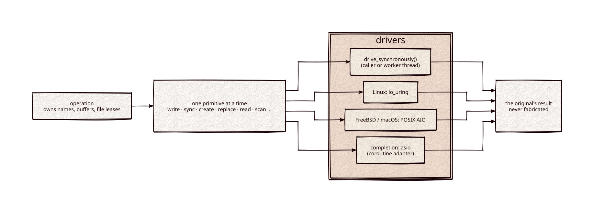

# completion

Part of [Kronuz C++ Libraries](https://github.com/Kronuz/cpp-libraries), a collection of small, reusable C++ libraries.

[](https://github.com/Kronuz/completion/actions/workflows/ci.yml)
[](LICENSE)


Owned file I/O for C++20: io_uring and POSIX AIO drivers that keep every in-flight buffer alive
until the kernel is done. An operation owns its buffers, names and file leases and issues one
primitive at a time to whichever driver the host runs: synchronous, io_uring on Linux, POSIX
AIO on FreeBSD and macOS, or `task::task` coroutines on Asio. A hardened directory backend and explicit file
and directory barriers make writes durable. It is the storage layer under
[journal](https://github.com/Kronuz/journal) and [strata](https://github.com/Kronuz/strata).



## ✨ Highlights

- **Results are never faked.** An accepted operation keeps its buffers, names and file leases
  until the original primitive completes; cancellation cannot fabricate a result or free
  memory the kernel is using.
- **One state machine, four drivers.** The same primitives run synchronously, on io_uring, on
  POSIX AIO, or through the `completion::asio` adapter. `completion_ref` (`completion::task`)
  is the one handle a coroutine awaits for any of them, plus `InlineCompletion` and a
  `HeldCompletion` that lets a test hold, reorder and release each primitive.
- **A hardened directory backend.** `PosixIO` rejects symlinks, hard links, foreign-owned and
  group- or world-writable files, and unsafe names; creation is exclusive. The root must be
  owned and private, unless `PosixIOOptions` admits it and the host warns.
- **Explicit durability.** File and directory barriers are separate calls, and `sync_files`
  batches files across devices. Every `PosixIO` names its flush mode, with no default; see
  [flush modes](#-flush-modes).
- **Zero-copy reads.** `File::map()` gives a read-only view of a whole file.
- **Allocation-aware.** Optional PMR contexts from
  [allocators](https://github.com/Kronuz/allocators) account every control block, queue and
  name, so a service can admit its memory up front.

## 🚀 Quick start

Write a file and make it durable through the trusted-directory backend:

```cpp
#include "completion/api.h"

#include <cstdio>
#include <string_view>

namespace c = kronuz::io::completion;

int main() {
	c::PosixIO io("data", {.flush_mode = c::FlushMode::full});  // an existing private directory
	// Exclusive across processes: the directory, then owner.lock, created once.
	auto owner = io.acquire_owner(c::OwnerLockOptions{c::OwnerLockMode::both, c::OwnerFile::create_exclusive});
	auto file = io.create_exclusive("record");
	std::string_view bytes = "durable bytes\n";
	for (std::size_t at = 0; at < bytes.size();) {
		auto n = file->write_at(at, bytes.substr(at));   // writes may be short
		if (n == 0) { return 1; }
		at += n;
	}
	file->sync();                                  // F_FULLFSYNC on macOS, in full mode
	io.sync_directory();                           // the name is durable too
	std::puts("record is durable");               // record is durable
}
```

[`examples/demo.cc`](examples/demo.cc) makes files in two directories durable with one
`sync_files` call.

## 💾 Flush modes

`PosixIOOptions::flush_mode` is required: `PosixIOOptions{}` and a `PosixIO` without options do
not compile. Every sync the backend and its files issue follows it: `File::sync`, `File::sync_data`
(the turn barrier's `SyncData`), `sync_files`, `sync_files_and_directory`,
`order_files_and_directory`, `sync_directory` and the creation of `owner.lock`.

| Platform | `full` | `plain` |
|---|---|---|
| macOS | `F_FULLFSYNC` for every durable sync and ordering point (a batch: `fsync` each, then one per device) | `fsync` for durable syncs; one `F_BARRIERFSYNC` per ordering point, or `F_FULLFSYNC` where the filesystem lacks the barrier (the call fails where that is unsupported too) |
| Linux | `fsync`; `fdatasync` for `sync_data`; writeback hints before a batch | the same calls |
| FreeBSD | `fsync` | the same calls |

On macOS, `fsync` hands the data to the drive and leaves it in the drive's cache: a power loss can
drop it, or write it out of order, even after the call returned. Only `F_FULLFSYNC` survives power
loss there, so `plain` survives an application or kernel crash, not a power loss. `F_BARRIERFSYNC` orders without flushing, and Apple guarantees the order only on Apple SSDs.
`plain` matches Xapiand's write-ahead log on macOS. In `full` mode an unsupported or failing
`F_FULLFSYNC` fails the call; it never falls back to `fsync`. A file keeps the mode of the backend
that opened it: in another backend's batch, a `full` file the batch would sync with less flushes
itself first. `FlushMode::Value` has no zero, and a value other than `plain` or `full` is refused
with `std::invalid_argument`.

## 📦 Installation

Requires a C++20 compiler and CMake 3.16 or newer; it fetches
[metrics](https://github.com/Kronuz/metrics) and [allocators](https://github.com/Kronuz/allocators)
at pinned commits. The `completion::asio` driver also fetches [task](https://github.com/Kronuz/task) (and, through it, standalone Asio unless `-DASIO_INCLUDE_DIR` names a checkout) when `COMPLETION_ASIO` is on, which it is by default only for a top-level build. CI builds it on Linux
(x86_64, arm64), macOS (arm64, x86_64), and FreeBSD, plus ASan, UBSan, and TSan builds.

```cmake
include(FetchContent)
FetchContent_Declare(completion
  GIT_REPOSITORY https://github.com/Kronuz/completion.git
  GIT_TAG        5ef01ad2d5acadcfb919da82e4fafb3283b4b448)  # main tracks the tip
FetchContent_MakeAvailable(completion)

target_link_libraries(my_app PRIVATE completion::completion)   # or completion::asio (set(COMPLETION_ASIO ON) first)
```

Then `#include "completion/api.h"` and use `kronuz::io::completion`; the task driver is
`completion/asio_completion.h`: `AsioCompletionDriver<Queue>(task::asio_scheduler&, queue)` and
`task::task<void> run(operation)`.

## 🎯 When to use it

It fits storage engines and logs that need real durability and asynchronous file I/O without
losing ownership of in-flight work.

Not for:

- **General file utilities or network I/O.** It is a narrow, durability-first storage layer.
- **Shared or untrusted directories.** The backend expects a private directory it owns, with
  trusted ancestors; the options that relax the root check leave every entry inside it
  no-follow.
- **Owner locks on network filesystems.** A `flock` over NFS or SMB may exclude only local
  holders; `directory_filesystem()` reports whether the filesystem is known local so the host
  can warn.

## 📚 Documentation

- [ARCHITECTURE.md](ARCHITECTURE.md): the ownership contract, the backend, owner locks,
  directory trust, image jobs, scanning, leases, reusable controls and the drivers.
- [docs/mechanisms/flush-mode.md](docs/mechanisms/flush-mode.md): the flush mode every sync
  follows, and what survives a crash or a power loss in each.
- [docs/mechanisms/commit-barriers.md](docs/mechanisms/commit-barriers.md): one flush and one
  ordering point per commit on macOS.
- [docs/PLATFORM_FINDINGS.md](docs/PLATFORM_FINDINGS.md): what durability and reclamation cost
  on macOS, Linux and FreeBSD.
- [docs/MEASUREMENTS.md](docs/MEASUREMENTS.md): qualification runs and object sizes.
- [CHANGELOG.md](CHANGELOG.md): changes, newest first.
- [AGENTS.md](AGENTS.md): repository map and the rules for changing I/O code.
- [Catalog entry](https://github.com/Kronuz/cpp-libraries/blob/main/AGENTS.md#completion) in
  Kronuz C++ Libraries.

## 🛠️ Building and testing

```sh
cmake -S . -B build -DCMAKE_BUILD_TYPE=Release
cmake --build build -j2
ctest --test-dir build --output-on-failure
```

The task driver's test builds with it (`-DCOMPLETION_ASIO=OFF` skips it); add `-DASIO_INCLUDE_DIR=/path/to/asio/include` to reuse an Asio checkout instead of fetching one.

## 🤝 Contributing

Issues and pull requests are welcome. I/O changes need tests that hold an original in flight
and drive it after the facade is gone. Read [AGENTS.md](AGENTS.md) and the catalog's
[rules of engagement](https://github.com/Kronuz/cpp-libraries/blob/main/AGENTS.md#rules-of-engagement)
first; CI must pass on every platform.

## 📄 License

MIT, Copyright (c) 2026 Germán Méndez Bravo. See [LICENSE](LICENSE).
