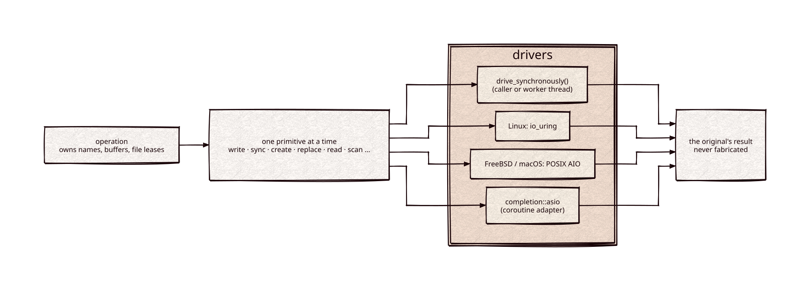

# completion

[](https://github.com/Kronuz/completion/actions/workflows/ci.yml)
[](LICENSE)


Owned, completion-driven file I/O for C++20: a hardened POSIX backend, and
operations that run synchronously, on Linux io_uring, on POSIX AIO (FreeBSD and
macOS), or under Asio coroutines, without ever losing track of an in-flight
write. The storage layer under [journal](https://github.com/Kronuz/journal) and
[strata](https://github.com/Kronuz/strata).



## ✨ Highlights

- **Nothing is ever faked.** An accepted operation keeps its buffers, names, and
  file leases until the original primitive completes; cancellation cannot
  fabricate a result or free memory the kernel is using.
- **One state machine, four drivers.** The same primitives run synchronously, on
  io_uring, on POSIX AIO, or through the `completion::asio` adapter.
- **A hardened directory backend.** `PosixIO` rejects symlinks, hard links,
  foreign-owned and world-writable files, and unsafe names; creation is exclusive.
- **Durability done right.** `F_FULLFSYNC` on macOS, batched `sync_files` across
  devices, and separate file and directory barriers.
- **Zero-copy reads.** `File::map()` gives a read-only view of a whole file.
- **Allocation-aware.** Optional PMR contexts account every control block,
  queue, and name, so a service can admit its memory up front.

## 📦 Installation

Requires a C++20 compiler and CMake 3.16 or newer; it fetches
[metrics](https://github.com/Kronuz/metrics) at a pinned commit. The Asio adapter
needs standalone Asio from the host. CI builds it on Linux (x86_64, arm64), macOS
(arm64, x86_64), and FreeBSD, plus ASan, UBSan, and TSan builds.

```cmake
include(FetchContent)
FetchContent_Declare(completion
  GIT_REPOSITORY https://github.com/Kronuz/completion.git
  GIT_TAG        main)
FetchContent_MakeAvailable(completion)

target_link_libraries(my_app PRIVATE completion::completion)   # or completion::asio
```

## 🚀 Quick start

Write a file and make it durable through the trusted-directory backend:

```cpp
#include "completion/posix.h"

#include <string_view>

int main() {
	kronuz::journal::PosixIO io("data");          // an existing private directory
	auto owner = io.acquire_owner(true);           // exclusive across processes
	auto file = io.create_exclusive("record");
	std::string_view bytes = "durable bytes\n";
	for (std::size_t at = 0; at < bytes.size();) {
		auto n = file->write_at(at, bytes.substr(at));   // writes may be short
		if (n == 0) { return 1; }
		at += n;
	}
	file->sync();                                  // F_FULLFSYNC on macOS
	io.sync_directory();                           // the name is durable too
}
```

[`examples/demo.cc`](examples/demo.cc) makes files in two directories durable with
one `sync_files` call.

## 🎯 When to use it

- ✅ Storage engines and logs that need real durability and asynchronous I/O
  without losing ownership of in-flight work.
- ❌ General file utilities or network I/O: this is a narrow, durability-first
  storage layer.
- ❌ Shared or untrusted directories: the backend requires a private directory it
  owns.

## 📚 Documentation

- [ARCHITECTURE.md](ARCHITECTURE.md): the ownership contract, the backend, image
  jobs, scanning, leases, reusable controls, and the drivers.
- [docs/PLATFORM_FINDINGS.md](docs/PLATFORM_FINDINGS.md): what durability and
  reclamation cost on macOS, Linux, and FreeBSD.
- [docs/MEASUREMENTS.md](docs/MEASUREMENTS.md): qualification runs and object
  sizes.
- [AGENTS.md](AGENTS.md): repository map and the rules for changing I/O code.

## 🛠️ Building and testing

```sh
cmake -S . -B build -DCMAKE_BUILD_TYPE=Release
cmake --build build -j2
ctest --test-dir build --output-on-failure
```

Add `-DASIO_INCLUDE_DIR=/path/to/asio/include` to also build the coroutine
adapter's test.

## 🤝 Contributing

Issues and pull requests are welcome. I/O changes need tests that hold an original
in flight and drive it after the facade is gone; read [AGENTS.md](AGENTS.md)
first. CI must pass on every platform.

## 📄 License

MIT, Copyright (c) 2026 Germán Méndez Bravo. See [LICENSE](LICENSE).
