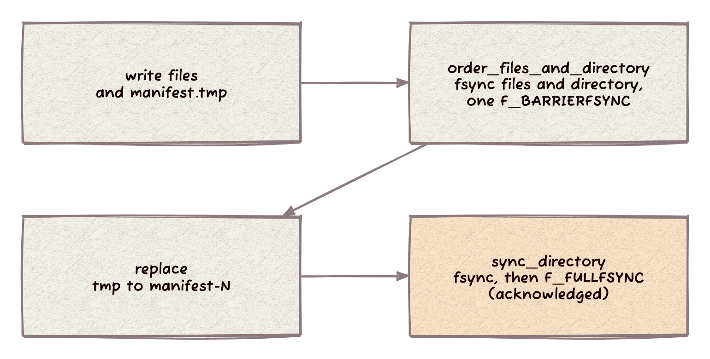

> Status: CURRENT (2026-11-24) the macOS sync paths of `PosixIO` in each flush mode (`flush-mode.md`); the numbers below predate the modes. Source chapter for the Architecture and Design book, section 5.1.

# Commit barriers: one flush, one ordering point

A commit that publishes a manifest by rename needs three facts in order: the data files are on the media, the manifest temporary is on the media, and only then the rename reaches the media. On macOS a full flush (`F_FULLFSYNC`) costs about 20 ms, so the naive protocol (a flush per step, four per commit) dominates the commit. `PosixIO` reduces it to one ordering point and one acknowledgement: in full mode two `F_FULLFSYNC`, in plain mode one `F_BARRIERFSYNC` and no full flush, so the drive's cache holds the commit until the drive writes it (`flush-mode.md`).

Linux and FreeBSD are unchanged: both calls run `sync_files` and then `sync_directory` there. The asynchronous driver runs them as one primitive each (`sync-files.md`).

## How it works

The order of calls in one commit (`posix.h:607` and `posix.h:614`):

- **Stage, then flush each device once.** `files_sync_devices` (`posix_sync.h`) fsyncs every file and the directory first. In full mode it then flushes each distinct device once, so a batch whose files share the directory's device pays one flush, not one per file; in plain mode the fsyncs are the whole durable sync.
- **Directory joins the data batch.** `sync_files_and_directory` (`io.h`, `posix.h`) is `sync_files` then `sync_directory`; in full mode the same single `F_FULLFSYNC` makes both durable. It serves a publication with no rename after it.
- **One barrier orders the manifest temporary.** In plain mode, `order_files_and_directory` (`io.h`, `posix.h`) stages the files, the manifest temporary and the directory, then issues `F_BARRIERFSYNC` on the directory's device; in full mode it is the durable sequence, one `F_FULLFSYNC`. `fcntl(2)` documents the barrier as ordering only: I/O fsynced before it persists before I/O issued after it. The rename comes after, so a manifest visible after power loss is complete and every file it names is on the media. Strata's commit calls it between writing the temporary and the `replace` (`strata/include/strata/core/index.hh:4521`).
- **The final flush acknowledges, in full mode.** `sync_directory` fsyncs the directory and, in full mode, runs `F_FULLFSYNC`, through the owner file when one is held. It flushes everything before it, so an acknowledged commit is durable. In plain mode it is the directory `fsync` alone: an acknowledged commit survives an application or kernel crash, and a power loss can drop it.
- **Other devices.** In full mode a file on a device other than the directory's gets `F_FULLFSYNC` inside the ordering call; in plain mode it keeps its `fsync`. The barrier orders only its own device.

## Fail closed

`SyncCalls::barrier` (`posix_sync.h`) retries on `EINTR`. It falls back to `F_FULLFSYNC` only when `barrier_unsupported(errno)`: `ENOTSUP`, `EOPNOTSUPP` or `ENOTTY` (an unrecognized `fcntl` command returns `ENOTTY` on macOS). Every other error, `EIO` among them, is returned and the commit fails with "order journal files". `EINVAL` does not count as unsupported: `fcntl(2)` lists no such use. A barrier that fell back after an `EIO` would turn a failed write into an acknowledged commit. Full mode issues no barrier, and a failed `F_FULLFSYNC`, unsupported or not, fails the call: it never falls back to `fsync`.

## The mode and the seam

- `PosixIOOptions::flush_mode` (required, no default) chooses the calls above (`flush-mode.md`).
- `PosixIO::replace_sync_calls(fsync_call, fcntl_call)` (macOS) swaps the system calls every sync path issues, `File::sync` and `File::sync_data` included. `test/sync_calls_test.cc` records the real call sequence on a real directory and asserts it exactly per mode (`plain_protocol`, `full_protocol`, `full_refusal`); `test/sync_primitives_test.cc` asserts every call site through the IO methods, `drive_synchronously` and the native queue.

## What the barrier guarantees

Apple documents `F_BARRIERFSYNC` as implemented on HFS and APFS and requiring hardware support that Apple SSDs are guaranteed to provide. On external or third-party drives, Fusion or AppleRAID sets and virtual disks, what APFS does with the call is undocumented. If it degrades to a plain `fsync`, a power loss can leave a visible manifest whose files are not on the media. Strata refuses to open that index rather than serve wrong data. Plain mode issues no full flush after it, so its acknowledged commits are no more durable than the drive's cache.

The owner ruled on 2026-10-29 that non-Apple storage keeps the barrier with a warning (`docs/reviews/commit-barriers-durability.md` Q1 in strata, `docs/status/t11-barriers.md` item 4 in Xapiand), and on 2026-11-24 that plain mode matches Xapiand's write-ahead log (Xapiand PLAN D177); full mode is the caller's choice for storage it cannot vouch for or data that must survive power loss. `PosixIOOptions::barrier_warning` reports each volume where a barrier ordered on storage other than an internal Apple SSD, once per process (`barriers.md`).

## Numbers

Probe `bench/commit_probe.cc` (`-DCOMPLETION_BUILD_BENCH=ON`, then `completion_commit_probe DIRECTORY 30 3 9`): one commit shape per pattern (3 or 9 files of 200 KB, a manifest temporary, a rename), 30 interleaved rounds, median, macOS x86_64 APFS, on an otherwise idle machine (`docs/PLATFORM_FINDINGS.md`, "Fewer flushes per commit"). `test/sync_calls_test.cc` asserts the call sequences the library issues.

| Pattern | Device flushes | 3 files | 9 files |
|---|---|---:|---:|
| Four separate flushes | 4 full | 85.7 ms | 89.6 ms |
| Directory folded in | 3 full | 63.9 ms | 68.9 ms |
| Temporary ordered | 2 full, 1 barrier | 45.1 ms | 48.9 ms |
| One ordering point | 1 full, 1 barrier | 24.9 ms | 27.9 ms |

The commit blocks its writer for about 25 ms instead of 86 ms. Strata's T11 bulk load of 20,000 documents (five interleaved rounds) takes 3.39 s instead of 2.90 s of wall time, 17% more documents per second. Whole-process CPU per document stays flat (0.818 to 0.809 ms): the saving is time blocked on the device, not computation. The profile's engine row counts that wait as busy, so it falls from 0.205 to 0.163 ms per document (Xapiand `docs/perf/t11-barriers/README.md`).

The table measures the protocol before flush modes, one barrier and one final full flush per commit; neither mode issues it now. Full mode is two full flushes per commit, plain mode one barrier and none.

Not measured: either mode's commit cost, macOS arm64, power loss on hardware, Linux and FreeBSD (unchanged by construction).

## Invariants

- Every file and the directory are fsynced before the barrier; the rename is issued after it.
- In full mode every acknowledged commit ends in `fsync` plus `F_FULLFSYNC` on the directory; in plain mode, in its `fsync`.
- A barrier error other than the three unsupported codes fails the call and is never retried as a full flush.
- Each distinct device is flushed once per call.

## Code

`include/completion/posix_sync.h`: `FlushMode`, `SyncCalls`, `files_sync_devices`. `include/completion/posix.h`: `PosixIO::sync_staged`, `order_files_and_directory`, `sync_directory`. `include/completion/io.h`: the virtual contracts. Tests: `test/sync_calls_test.cc`, `test/sync_files_test.cc`, `test/sync_primitives_test.cc`.
