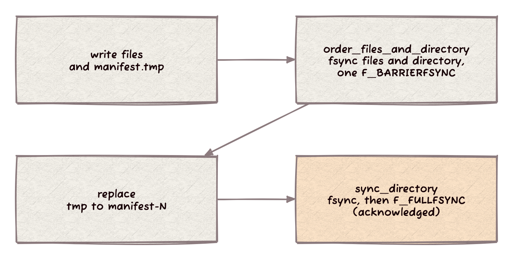

> Status: CURRENT (2026-10-30) the macOS sync paths of `PosixIO` at completion main `03cef1d`. Source chapter for the Architecture and Design book, section 5.1.

# Commit barriers: one flush, one ordering point

A commit that publishes a manifest by rename needs three facts in order: the data files are on the media, the manifest temporary is on the media, and only then the rename reaches the media. On macOS a full flush (`F_FULLFSYNC`) costs about 20 ms, so the naive protocol (a flush per step, four per commit) dominates the commit. `PosixIO` reduces it to one `F_FULLFSYNC` and one `F_BARRIERFSYNC`.

Linux and FreeBSD are unchanged: both calls run `sync_files` and then `sync_directory` there (`posix.h:596-612`).

## How it works

The order of calls in one commit (`posix.h:607` and `posix.h:614`):

- **Stage, then flush each device once.** `files_sync_devices` (`posix.h:186`) fsyncs every file and the directory first. It then flushes each distinct device once, so a batch whose files share the directory's device pays one flush, not one per file.
- **Directory joins the data batch.** `sync_files_and_directory` (`io.h:231`, `posix.h:596`) is `sync_files` then `sync_directory` made durable by the same single `F_FULLFSYNC`. It serves a publication with no rename after it.
- **One barrier orders the manifest temporary.** `order_files_and_directory` (`io.h:240`, `posix.h:607`) stages the files, the manifest temporary and the directory, then issues `F_BARRIERFSYNC` on the directory's device. `fcntl(2)` documents the barrier as ordering only: I/O fsynced before it persists before I/O issued after it. The rename comes after, so a manifest visible after power loss is complete and every file it names is on the media. Strata's commit calls it between writing the temporary and the `replace` (`strata/include/strata/core/index.hh:4521`).
- **The final flush acknowledges.** `sync_directory` fsyncs the directory and runs `F_FULLFSYNC`, through the owner file when one is held (`posix.h:614-625`). It flushes everything before it, so an acknowledged commit is durable whatever the barrier did.
- **Other devices flush in full.** A file on a device other than the directory's gets `F_FULLFSYNC` inside the ordering call (`posix.h:220-222`): the barrier orders only its own device.

## Fail closed

`DeviceSyncCalls::barrier` (`posix.h:149`) retries on `EINTR`. It falls back to `F_FULLFSYNC` only when `barrier_unsupported(errno)` (`posix.h:140`): `ENOTSUP`, `EOPNOTSUPP` or `ENOTTY` (an unrecognized `fcntl` command returns `ENOTTY` on macOS). Every other error, `EIO` among them, is returned and the commit fails with "order journal files" (`posix.h:218-219`). `EINVAL` does not count as unsupported: `fcntl(2)` lists no such use. A barrier that fell back after an `EIO` would turn a failed write into an acknowledged commit.

## Two knobs

- `PosixIO::replace_sync_calls(fsync_call, fcntl_call)` (`posix.h:498`, macOS) swaps the system calls every sync path issues. `test/sync_calls_test.cc` records the real call sequence on a real directory and asserts it exactly: the ordered call is "fsync each file, fsync the directory, one barrier, no flush", `sync_directory` is "fsync, full", a durable batch is one full flush, a foreign file syncs itself.
- `PosixIOOptions::full_flush_ordering` (`posix.h:421`, default `false`) makes `order_files_and_directory` use the durable mode, one `F_FULLFSYNC` where the barrier would go (`posix.h:609`). Test: `full_flush_option` (`sync_calls_test.cc:176-181`).

## What the barrier guarantees

Apple documents `F_BARRIERFSYNC` as implemented on HFS and APFS and requiring hardware support that Apple SSDs are guaranteed to provide. On external or third-party drives, Fusion or AppleRAID sets and virtual disks, what APFS does with the call is undocumented. If it degrades to a plain `fsync`, a power loss can leave a visible manifest whose files are not on the media. Strata refuses to open that index rather than serve wrong data, and acknowledged commits stay durable through the final `F_FULLFSYNC`.

The owner ruled on 2026-10-29 that non-Apple storage keeps the barrier with a warning, and `full_flush_ordering` is the opt-in for hosts that cannot vouch for their storage (`docs/reviews/commit-barriers-durability.md` Q1 in strata, `docs/status/t11-barriers.md` item 4 in Xapiand). Neither completion nor strata emits the warning yet, and strata's index options do not wire the option: both are open host follow-ups (grep of `full_flush_ordering` and the barrier path in `strata/include` finds no use).

## Numbers

Probe `commit_probe.cc` (not kept in the repository): one commit shape per pattern (3 or 9 files of 200 KB, a manifest temporary, a rename), 30 interleaved rounds, median, macOS x86_64 APFS, on an otherwise idle machine (`docs/PLATFORM_FINDINGS.md`, "Fewer flushes per commit"). `test/sync_calls_test.cc` asserts the call sequences the library issues.

| Pattern | Device flushes | 3 files | 9 files |
|---|---|---:|---:|
| Four separate flushes | 4 full | 85.7 ms | 89.6 ms |
| Directory folded in | 3 full | 63.9 ms | 68.9 ms |
| Temporary ordered | 2 full, 1 barrier | 45.1 ms | 48.9 ms |
| One ordering point | 1 full, 1 barrier | 24.9 ms | 27.9 ms |

The commit blocks its writer for about 25 ms instead of 86 ms. Strata's T11 bulk load of 20,000 documents (five interleaved rounds) takes 3.39 s instead of 2.90 s of wall time, 17% more documents per second. Whole-process CPU per document stays flat (0.818 to 0.809 ms): the saving is time blocked on the device, not computation. The profile's engine row counts that wait as busy, so it falls from 0.205 to 0.163 ms per document (Xapiand `docs/perf/t11-barriers/README.md`).

Not measured: macOS arm64, power loss on hardware, Linux and FreeBSD (unchanged by construction).

## Invariants

- Every file and the directory are fsynced before the barrier; the rename is issued after it.
- Every acknowledged commit ends in `fsync` plus `F_FULLFSYNC` on the directory.
- A barrier error other than the three unsupported codes fails the call and is never retried as a full flush.
- Each distinct device is flushed once per call.

## Code

`include/completion/posix.h`: `DeviceSyncCalls`, `files_sync_devices`, `PosixIO::sync_staged`, `order_files_and_directory`, `sync_directory`. `include/completion/io.h:228-240`: the virtual contracts. Tests: `test/sync_calls_test.cc`, `test/sync_files_test.cc`.
